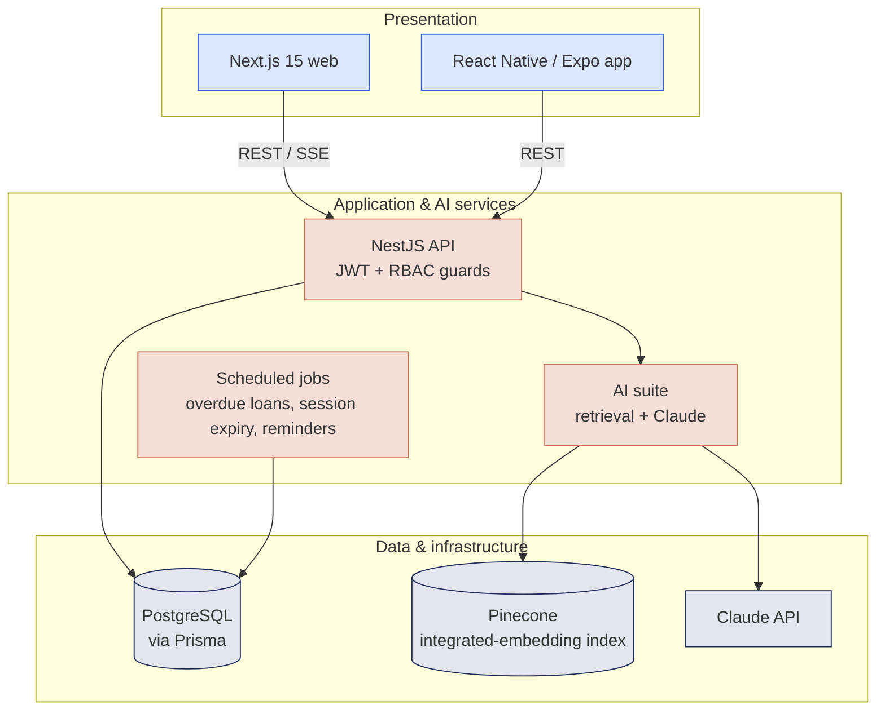

# SportsOS — AI-Powered Sports ERP for IIT (ISM) Dhanbad

Implementation of the thesis proposal *“SportsOS: An AI-Powered Sports ERP for IIT (ISM) Dhanbad”*
(Anup Kumar, 22JE0143 · Mentor: Prof. Scindhiya Laxmi · Department of Mathematics and Computing).

SportsOS replaces paper registers, spreadsheets and WhatsApp groups with one role-aware system for
facility booking, verified attendance, QR equipment tracking, tournaments, complaints and analytics,
with an AI assistant on top.

```
sportsos/
├── apps/
│   ├── api/        NestJS 11 + Prisma 6 + PostgreSQL   — REST API, jobs, AI suite
│   ├── web/        Next.js 15 (App Router) + Tailwind 4 — web client for every role
│   └── mobile/     Expo SDK 54 (React Native)           — check-in, QR scanner, bookings
├── packages/
│   └── shared/     roles, permission matrix and API wire types (used by api + web)
├── docs/API.md     REST contract, QR payloads, demo accounts
└── docker-compose.yml
```

## Architecture



## How the proposal maps to the code

| Proposal | Implementation |
|---|---|
| **O1** Centralise operations | One PostgreSQL schema (`apps/api/prisma/schema.prisma`) for facilities, bookings, clubs, attendance, inventory, tournaments, complaints and achievements. |
| **O2** Automate admin processes | Approval workflow with notifications, automatic conflict detection, scheduled jobs (`apps/api/src/jobs`) that close sessions, complete bookings, lapse unreviewed requests, flag overdue loans and send reminders. |
| **O3** Role-based access control | 18 roles (the 17 organisational roles plus the Director) and 70 granular permissions with an explicit, database-backed role→permission matrix; multiple scoped, time-bound roles per user with two-person approval for privileged roles (`apps/api/src/rbac`, [RBAC_PERMISSION_MATRIX.md](docs/RBAC_PERMISSION_MATRIX.md)). |
| **O4** Real-time analytics | KPIs, weekly participation, facility utilisation + weekday×hour heatmap, demand forecast, equipment wear, attendance-integrity report (`/analytics/*`). |
| **O5** Student experience | Single portal: bookings with QR gate passes, club membership, attendance history, achievements, notifications, complaints; mobile app for on-ground use. |
| **O6** Scalable, future-ready | Stateless API in Docker, Prisma migrations, pluggable vector store, AI features degrade gracefully when keys are absent. |
| Pillar 1 — Auth & RBAC, Asset & Club Hub | `auth`, `users`, `facilities`, `bookings`, `clubs` modules |
| Pillar 2 — Verified attendance, QR inventory | `attendance` (OTP + GPS geofence + device binding), `inventory` + `audit` (hash-chained ledger) |
| Pillar 3 — Events planner, AI analytics suite | `tournaments` (seeded brackets, round robin), `analytics`, `ai` (RAG assistant with voice in the web client, executive reports) |

## Key techniques

* **Verified attendance.** The coach's screen shows a 6-digit TOTP (RFC 6238 over HMAC-SHA1, 30 s steps; the
  implementation is tested against the RFC 4226 vectors). A check-in must carry the current or previous code, a GPS fix
  with accuracy ≤ 100 m, and a haversine distance from the facility centre ≤ radius + min(accuracy, 25 m). Each student
  gets one record per session and each device can check in only one student. Wrong-code attempts are capped at 5 per
  10 minutes, and every attempt (accepted or not) is logged for the integrity report. A device reused for a second
  student alerts the coach.
* **Tamper-evident ledger.** Every state change (bookings, loans, returns, restocks, results, role changes) appends to
  `AuditLog` inside the same transaction: `hash = SHA-256(prevHash ‖ canonical JSON(entry))`. A Postgres advisory lock
  serialises appends, and `GET /audit/verify` recomputes the chain and reports the first broken link.
* **Conflict-free booking.** Overlap checks run under a per-facility advisory lock, so two concurrent requests can't
  both win a slot. Stock decrements use a conditional `UPDATE … WHERE availableQty >= n`, so stock can't be overdrawn.
* **Fixtures.** Single elimination uses standard seeding (1 v 8, 4 v 5, …) with byes going to the top seeds and winners
  advancing automatically. Round robin uses the circle method, and standings award 3/1/0 points with goal-difference
  tie-breaks.
* **Demand forecasting.** Additive Holt-Winters (ETS(A,A,A)) with a weekly season. α, β and γ are chosen by grid search
  on one-step-ahead SSE, and the 95 % intervals come from σ²ₕ = σ²(1 + Σⱼ cⱼ²), cⱼ = α(1 + jβ) + γ·[j mod 7 = 0].
* **AI suite.** Live ERP state is rendered into retrieval documents: aggregates only, no student personal data. They are
  indexed in Pinecone (an integrated-embedding index with `llama-text-embed-v2`, created on first use), or in an
  in-process BM25 index when no Pinecone key is set. Claude (`claude-opus-5-5`, server-side refusal fallback enabled)
  answers grounded questions over SSE and writes executive reports. Without an Anthropic key the assistant returns
  the retrieved facts and a templated report.

## Getting started

Requirements: Node.js ≥ 20, npm ≥ 10, Docker (for PostgreSQL).

### Option A — everything in Docker

```bash
cd sportsos
docker compose up -d --build
docker compose exec api npm run seed
open http://localhost:3000          # sign in as peso@sportsos.demo / sportsos123 (synthetic demo account)
```

### Option B — local development

```bash
cd sportsos
npm install                          # installs api + web + shared, builds shared, generates Prisma client
docker compose up -d postgres        # PostgreSQL on localhost:5432
cp apps/api/.env.example apps/api/.env
npm run db:migrate                   # applies prisma/migrations
npm run db:seed                      # SYNTHETIC demo data (refuses to wipe non-demo data), password sportsos123
npm run dev:api                      # http://localhost:4000/api
npm run dev:web                      # http://localhost:3000
```

Mobile app (separate install, so Expo keeps its own React version):

```bash
cd apps/mobile
npm install
cp .env.example .env                 # on a phone, set EXPO_PUBLIC_API_URL to your computer's LAN IP
npx expo start                       # scan the QR with Expo Go
```

For a phone to reach the API, add its origin to `CORS_ORIGINS` only if you use the web build of the app; native
requests aren't subject to CORS.

### AI configuration (optional)

In `apps/api/.env`:

```
ANTHROPIC_API_KEY=sk-ant-…          # enables Claude answers and reports
PINECONE_API_KEY=…                  # enables Pinecone; otherwise local BM25 retrieval is used
```

`GET /api/ai/status` reports which mode is active. The index is rebuilt at startup and every 30 minutes, or on
demand with `POST /api/ai/reindex`.

### Demo accounts

All demo passwords are `sportsos123`. **Every seeded account, facility and record is synthetic** (`isDemo`, `[DEMO]` names,
`@sportsos.demo` emails, `ZZ` admission numbers, `Hostel A–I`). Real IIT (ISM) data enters only through the admin import;
see [docs/IIT_ISM_DATA_INTEGRATION.md](docs/IIT_ISM_DATA_INTEGRATION.md). A few useful accounts (full list in
[docs/API.md](docs/API.md#demo-accounts-after-npm-run-dbseed)):

| Account | Sees |
|---|---|
| `peso@sportsos.demo` | Sports Officer: approvals, facilities, inventory, analytics, audit, AI reports, role assignment |
| `dean.sw@sportsos.demo` | Dean SW: institution-wide analytics, escalated complaints, event proposals, role approvals |
| `admin@sportsos.demo` | System Administrator: users, roles, permission matrix, imports, audit (no operational approvals) |
| `coach.football@sportsos.demo` | Starts verified-attendance sessions and manages the Football Club roster only |
| `club.member@sportsos.demo` | Club member: bookings, check-in, clubs, achievements |
| `media@sportsos.demo` | Media nominee **and** temporary Event Committee member: try the "Acting as" role switcher |
| `hostelsec.a@sportsos.demo` | Hostel A sports secretary: registers Hostel A teams only |
| `security@sportsos.demo` | Gate-pass check-in and the day's entry log (name and admission no. only) |

**Trying GPS check-in away from Dhanbad:** seeded facilities sit at placeholder coordinates near the campus
(≈ 23.814 N, 86.441 E). Sign in as `peso@sportsos.demo`, open the facility and use **Use my current location** to
move its geofence to where you are. Then start a session as a coach and check in from a phone.

## Testing

```bash
npm test                                  # unit tests: OTP (RFC vectors), geofence, hash chain, brackets, Holt-Winters
npm run test:smoke -w @sportsos/api       # 83 end-to-end checks against a running, freshly seeded API
npm run test:e2e -w @sportsos/api         # 200 RBAC / workflow checks across all 18 roles (writes TEST data)
npm run lint && npm run typecheck         # ESLint + TypeScript for api and web
npm run typecheck -w @sportsos/web        # web type check
(cd apps/mobile && npx tsc --noEmit)      # mobile type check
```

## Documentation

[Implementation audit](docs/SPORTSOS_IMPLEMENTATION_AUDIT.md) · [RBAC matrix](docs/RBAC_PERMISSION_MATRIX.md) ·
[IIT (ISM) data integration](docs/IIT_ISM_DATA_INTEGRATION.md) · [API](docs/API_DOCUMENTATION.md) ·
[Database changes](docs/DATABASE_CHANGES.md) · [Test report](docs/TEST_REPORT.md) ·
[Environment setup](docs/ENVIRONMENT_SETUP.md) · [Changelog](docs/IMPLEMENTATION_CHANGELOG.md)

## Security notes and limitations

* Passwords are hashed with bcrypt. JWTs are short-lived (12 h) and the user is re-loaded on every request, so
  deactivation and role changes take effect immediately. Rate limits are per account rather than per IP, since campus
  NAT shares addresses. `helmet` sets the headers, and validation whitelists every DTO. OTP secrets and password
  hashes are excluded from every query by default, and device IDs are never returned.
* The web client keeps its JWT in `localStorage`. Before production, move it to an httpOnly cookie behind
  the same origin.
* OTP and geofence checks raise the bar against proxy attendance considerably. They can't defeat a rooted phone
  that spoofs GPS while in the same room as the projected code. The integrity report and device-reuse alerts exist to
  surface those patterns.
* Facility coordinates in the seed are placeholders; survey each ground (the facility form can capture the
  current GPS position) before relying on geofences.
* The proposal targets Next.js 15. `npm audit` reports advisories in Next 15's bundled PostCSS and the Prisma CLI's
  config merger. Both run at build time on trusted input; upgrading to Next 16 / Prisma 7 clears them.

## Roadmap status (proposal §6)

| Milestone | Status |
|---|---|
| Aug 2026 — Requirements, SRS, wireframes | Proposal + this repository's API contract (`docs/API.md`) |
| Sep 2026 — Database & auth (PostgreSQL, NestJS) | Done — schema, migrations, JWT, RBAC |
| Oct 2026 — Club rosters, GPS/OTP attendance | Done |
| Nov 2026 — Booking grids, automated stock alerts | Done |
| Dec 2026 — Council hub & tournament brackets | Done |
| Jan 2027 — Pinecone, executive dashboards | Done (Pinecone optional; local fallback) |
| Feb 2027 — React Native client with QR | Done (Expo SDK 54) |
| Mar–Apr 2027 — Hardening, final demo | Partly done: rate limiting, audit chain, tests. Still to do: penetration testing, caching, load testing, field survey of geofences |
